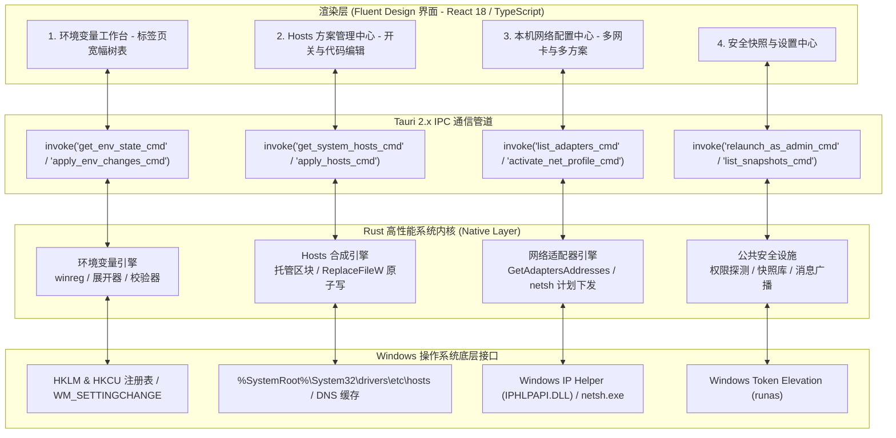

# EnvPilot

<div align="center">


### 🧭 EnvPilot - Windows 系统环境配置中心 (环境变量 / Hosts / 本机网络)

一款专为 Windows 10/11 平台打造的高性能系统环境一站式治理桌面应用，深度契合 Windows 11 Fluent Design 设计语言，基于 Tauri 2.x 与 Rust 原生底层系统内核驱动。

[](https://www.microsoft.com/windows)
[](https://tauri.app/)
[](https://www.rust-lang.org/)
[](https://developer.microsoft.com/fluentui)
[](LICENSE)

[核心特性](#-核心特性) • [功能板块](#-三大核心功能板块) • [架构图解](#-工作原理与系统架构) • [快速开始](#-快速开始) • [常见问题](#-常见问题--faq) • [开源协议](#-开源协议)

</div>

---

## 📖 项目简介

在 Windows 平台上的日常开发、运维与移动办公过程中，开发者与系统管理员长期面临三大高频、分散且极其容易误操作的系统级配置管理痛点：

- **环境变量维护繁琐易错**：Windows 自带的环境变量编辑窗口狭小，长路径容易被遮挡截断；缺乏失效路径与重复项探针；修改后常因未广播 `WM_SETTINGCHANGE` 导致终端无法立即感知，且无历史快照与安全回滚保障。
- **Hosts 方案切换混乱**：开发、测试与线上多套域名映射频繁交替，手动修改 `drivers\etc\hosts` 需繁琐提权；传统工具多采用全量覆盖模式，极易冲掉用户原有的个性化手写注释与本地规则。
- **本机网络环境配置繁重**：往返于公司静态内网、家庭自动 DHCP、客户机房与数据中心之间时，需要反复手动配置 IP 地址、子网掩码、网关、首选/备用 DNS 及系统代理。

**EnvPilot** 致力于成为 Windows 平台开发者的“系统环境驾驶舱”。以不到 15MB 的极致轻量身姿，将 **环境变量配置 (RapidEE 级体验)**、**Hosts 方案管理 (SwitchHosts! 级体验)** 与 **网络环境切换 (NetSetMan 级体验)** 深度融合在统一的 Windows 11 Fluent 视觉工作台中，并在底层依托 Rust 系统内核提供 **全流程校验、改动差异比对、自动安全快照与原子回滚** 闭环。

---

## ✨ 核心特性

- 🧩 **环境变量宽幅沉浸治理（标签页架构）**：
  - **杜绝长路径遮挡**：顶部 Fluent 标签页切换【系统变量】与【用户变量】，提供 1000px+ 宽幅单栏卡片树表，无论多长的工具链深层路径（JDK、mise、Node、Python、PowerShell 等）均可完整无遮挡呈现；
  - **智能类型识别**：精准区分并标出绿色 `abc` (REG_SZ 普通字符串)、蓝色 `%` (REG_EXPAND_SZ 可展开宏) 与灰色 `🔒` (动态只读变量)；
  - **有效性健康探针**：
    - 🔴 **失效路径标红**：自动探查路径实际存在性，不存在的目录标红警示，支持“仅显示失效路径”快速体检；
    - 🟡 **重复项标黄与一键去重**：自动对比规范化展开路径，排查冗余项并支持 `⚡ 一键去重`；
  - **全局即时生效**：写入后通过 Win32 API 自动广播全局 `WM_SETTINGCHANGE` 消息，新启动的终端或软件立即可用。
- 🌐 **Hosts 多方案敏捷切换与托管区块**：
  - **无损托管模式**：软件仅在 `# EnvPilot BEGIN` 与 `# EnvPilot END` 标记区间内合成并改写托管规则，区间外用户手写的内容 100% 完整保留；
  - **一键开关切换**：右侧开关随点随切，毫秒级合成并下发系统 hosts；
  - **原子安全写入**：采用临时文件与 Win32 `ReplaceFileW` 机制，自动处理系统 hosts 文件的只读属性，写入后自动调用 `ipconfig /flushdns` 刷新系统 DNS 缓存。
- 📶 **本机网络适配器与多方案调度**：
  - **真实物理硬件枚举**：基于 Win32 `GetAdaptersAddresses` 接口毫秒级探查本机所有网络适配器（友好别名、硬件设备描述、MAC、实时 IP、掩码、网关、DNS、连接与无线状态）；
  - **多网卡多页签绑定**：每个网络方案支持绑定多个网卡页签（如 `#1 WLAN`、`#2 以太网`），并提供 `⤓ 从当前物理配置一键读取` 瞬间完成采集；
  - **全链路参数托管**：支持 IPv4 自动获取(DHCP) / 静态配置(IP、子网掩码、默认网关)，DNS 自动获取 / 手动首选备用，以及 Windows 系统代理与 Hosts 方案联动激活。
- 🛡 **最小权限模型与全自动快照回滚**：
  - **非侵入式免提权**：默认以普通权限启动，所有只读浏览与用户变量修改均无需弹窗；仅在写入系统级配置时提示 `⚡ 以管理员身份重启`，且当前暂存修改会在重启后无缝保留；
  - **安全快照库**：所有写入操作均在执行前自动生成全量状态快照（保留最近 50 份），支持在设置面板中随时查阅并一键恢复。
- 🎨 **原生 Windows 11 Fluent 视觉**：完美契合系统亚克力磨砂、云母半透明质感，支持深色 / 浅色主题无缝切换。

---

## 🧩 三大核心功能板块

### 1. 环境变量配置中心 (Environment Hub)
- **宽幅全景树形展现**：支持按变量名/值模糊检索、仅显示失效路径过滤、显示/隐藏动态只读变量；
- **Path 深度展开管理**：一键展开 Path、PATHEXT 等多值变量的层级子项树；
- **安全写闭环**：修改操作处于暂存状态，点击应用前弹出 `DiffDialog` 差异对比确认框，确认后创建快照、更新注册表并广播系统消息。

### 2. Hosts 方案管理中心 (Hosts Hub)
- **多方案自由组合**：左侧方案列表管理（增删改查、排序、开关），支持首项“系统 Hosts 真实映射（只读防护）”；
- **等宽代码编辑体验**：支持行号、语法高亮与语法校验（如非法 IP 格式、行缺少主机名等错误标注）；
- **DNS 缓存自动刷新**：规则下发系统后自动清除本机 DNS 缓存，无需手动开启 CMD 执行命令。

### 3. 本机网络环境配置中心 (Network Hub)
- **多场景快速切换**：针对家、办公室、客户机房、数据中心等不同场景建立独立网络方案分组；
- **配置自由勾选应用**：可针对 IP 与网关、DNS 服务器、系统代理分别勾选是否在激活时进行修改；
- **系统代理与 Hosts 联动**：在切换到机房或办公网络时，可联动开启或关闭系统代理，并自动开启配套的 Hosts 屏蔽方案。

---

## 🛠️ 工作原理与系统架构



---

## 🚀 快速开始

### 📥 资产安装指南与选型

| 安装程序 / 格式 | 适用系统 | 架构 | 体积 | 适用场景 | 说明 |
| :--- | :--- | :--- | :--- | :--- | :--- |
| **`env-pilot-setup-v2.0.3-full-offline-x64.exe`** | Windows 10 / 11 | `x64` | **~150 MB** | **内网隔离机 / 纯离线环境 / 无 WebView2 系统** | **含 WebView2 离线完整版**（内置微软官方离线安装包，无网络或无 WebView2 环境 100% 自动静默安装可用） |
| **`env-pilot-setup-v2.0.3-x64.exe`** | Windows 10 / 11 | `x64` | **~4 MB** | **日常标准联网电脑（推荐大多数用户首选）** | **官方标准安装包**（向导式安装，体积轻巧，带桌面/开始菜单快捷方式与卸载程序） |
| **`env-pilot-portable-v2.0.3-x64.exe`** | Windows 10 / 11 | `x64` | **~4 MB** | **U 盘随身携带 / 即插即用 / 临时检修调试** | **单文件免安装便携版**（双击即用，不写注册表，U 盘即插即用） |
| **`env-pilot-v2.0.3-win-x64.zip`** | Windows 10 / 11 | `x64` | **~2 MB** | **自动化脚本分发 / 自定义工具目录 / CI 归档** | **绿色免安装压缩包**（解压到任意目录直接运行） |

### 环境依赖

- **操作系统**：Windows 10 1809 及以上 / Windows 11（推荐 64 位 x64 架构）
- **Node.js**：`>= 18.0.0`（系统已就绪 Node.js 22）
- **Rust 工具链**：`rustc >= 1.75.0`，`cargo`（系统已配置 `cargo 1.99.1`）

### 安装与运行

1. **直接启动桌面客户端 (推荐)**：
   - 双击根目录下的 **`启动桌面客户端.bat`**，或执行命令：
     ```powershell
     npm run tauri dev
     ```

2. **以热更新开发模式启动**：
   - 双击根目录下的 **`启动热更新开发环境.bat`**，或执行命令：
     ```powershell
     npm run start
     ```

3. **纯浏览器 Web 调试模式 (无需编译 Rust 内核)**：
   - 双击根目录下的 **`run-web.bat`**，浏览器访问 `http://localhost:1421` 查看 Fluent UI 界面。

---

## ❓ 常见问题 (FAQ)

### Q1: 修改系统环境变量为什么需要管理员权限？普通权限能用吗？
**答：能用。** EnvPilot 遵循最小权限安全原则：
- 在普通标准权限下，您可以完整浏览所有系统与用户变量、分析失效路径与重复项，并可**无感直接修改当前用户的环境变量**；
- 仅当您修改系统级变量（影响整台电脑所有用户）时，才需要写入 `HKLM` 注册表键。点击标题栏的 `⚡ 以管理员身份重启` 即可完成提权，您在重启前暂存的修改会自动随新进程恢复，无需重新录入。

### Q2: 切换 Hosts 方案会不会冲掉我原先在 hosts 文件里手写的内容？
**答：绝对不会。** EnvPilot 默认采用**托管区块隔离模式**。软件只会将规则写入 `# EnvPilot BEGIN` 与 `# EnvPilot END` 两个安全标记之间。您在标记区间之外手写的任何自定义域名映射、本地测试规则或中文注释都会被完整保留。

### Q3: 切换网络配置会不会导致断网或静态网关残留？
**答：不会。** EnvPilot 在下发网络配置前会自动采集当前网卡状态并生成全量快照。当从静态 IP 切换回自动 DHCP 时，执行引擎会自动重置网卡地址源并清空残留的静态路由与网关，激活完成后自动轮询验证网卡连通性。如遇意外断开，可在设置面板中通过快照一键秒级回滚。

### Q4: 修改环境变量或 Hosts 之后需要重启电脑吗？
**答：不需要。**
- 环境变量写入后，软件会自动调用 Win32 API 向 Windows 系统发送 `WM_SETTINGCHANGE` 广播，新启动的命令行、终端与应用会立即感知新变量；
- Hosts 写入后，软件会自动静默调用系统接口刷新本机 DNS 解析器缓存 (`ipconfig /flushdns`)，新规则毫秒级生效。

---

## 📄 开源协议

本项目基于 [MIT 协议](LICENSE) 开源。
